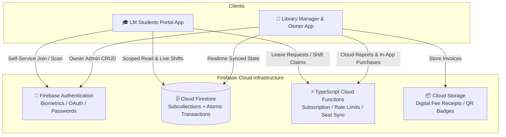

<div align="center">

  

  # 📚 Library Manager Ecosystem
  ### Next-Gen Dual-App SaaS Platform for Library Owners & Students

  <p align="center">
    <b>A high-performance, enterprise-grade library management ecosystem engineered with Flutter & Firebase.</b>
  </p>

  <!-- Badges -->
  <p align="center">
    <a href="https://flutter.dev/"></a>
    <a href="https://dart.dev/"></a>
    <a href="https://firebase.google.com/"></a>
    <a href="https://www.typescriptlang.org/"></a>
    <a href="#"></a>
  </p>

  <p align="center">
    <a href="#-architecture-overview">Architecture</a> •
    <a href="#-dual-app-ecosystem">Apps</a> •
    <a href="#-security--zero-secrets-policy">Security</a> •
    <a href="#-features-matrix">Features</a> •
    <a href="#-getting-started">Setup</a> •
    <a href="#-production-builds">Release</a>
  </p>

</div>

---

##  Architecture Overview

This repository is structured as a unified monorepo housing both client applications and the backend infrastructure:

```
📦 Library Manager Ecosystem
 ├── 📱 android/ & lib/               # Owner App (com.librarymanager.owner)
 ├── 🎓 library_student_app/          # Student Portal App (com.librarymanager.student)
 ├── ⚡ firebase/
 │    ├── 📜 firestore.rules          # Granular multi-tenant RBAC rules
 │    ├── 📜 storage.rules            # Secure bucket asset rules
 │    └── 💻 functions/src/           # Cloud Functions (TypeScript)
 │         ├── subscription_validation.ts  # Atomic Play Store receipt verification
 │         ├── attendance_alerts.ts        # Automated student check-in alerts
 │         ├── fee_reminders.ts            # Scheduled overdue notifications
 │         ├── student_library.ts          # Shift seats & membership workflows
 │         └── rate_limit.ts               # Brute-force & DDoS protection
 └── 📄 tos.md & privacy.md           # Legal & Google Play Trader / DSA Compliance
```



---

##  Dual-App Ecosystem

### 1. 🏢 Library Manager and Owner (Admin App)
*Target: Library Owners & Management Staff*
- **Shift-Wise Seat Management**: Real-time visual seat grid with multi-shift occupancy support (Morning, Afternoon, Evening, Night, Full-Day).
- **Automated Digital Fee Receipts**: Generates dynamic branded fee receipts, handles partial payments, discounts, and overdue tracking.
- **Biometric Security Vault**: Local authentication gate with cryptographic PIN/Biometric lock and automatic inactivity cooldown.
- **Offline Attendance Sync**: Zero-downtime offline attendance queue with poison-pill retry guards that automatically syncs once connection is restored.
- **Operational Expense Tracker**: Category-wise expense logging with monthly financial analytics.
- **Dynamic Notice Board**: Push notices, announcements, and operational guidelines straight to all registered students.
- **Auto Cloud Backup**: Multi-chunk Firestore document backups to bypass the 1MB document threshold.

### 2. 🎓 LM Students Portal (Student Self-Service)
*Target: Registered Students & Aspirants*
- **One-Tap QR / Code Joining**: Enter library token to bind student profile instantly.
- **Real-Time Seat Availability**: Live visualization of vacant seats and shifts.
- **Attendance History & Analytics**: Personal attendance logs with strict PII isolation (scoped strictly to own records).
- **Instant Digital Notices**: Real-time notifications for library timings, fees, holidays, and rules.
- **Leave Request Management**: Submit and track leave requests with automated seat retention.

---

##  Security & Zero-Secrets Policy

This codebase strictly adheres to **Enterprise DevSecOps Zero-Trust** standards:

| Security Vector | Implementation Detail |
|---|---|
| 🔑 **Zero-Secret Repository** | Keystore passwords, signing files (`*.jks`, `key.properties`), and private Firebase configs are 100% ignored via `.gitignore`. Sample templates provided. |
| 🛡️ **Google Play Trader / DSA** | App-Level Trader verification compliant under **SHARP OP** (UDYAM-UP-18-0090815). |
| ⚡ **Atomic In-App Purchases** | Google Play subscription validation runs inside Firestore transactions preventing duplicate token reuse attacks. |
| 🔒 **Granular Firestore Rules** | Multi-tier security rules ensuring students can NEVER read other students' data or modify seat allocations without server validation. |
| 🧬 **Code Minification & Obfuscation** | Release builds enforce R8 shrinking and Dart-level AOT symbol obfuscation with split debug info. |

---

##  Security Setup & Environment Templates

To clone and build locally without committing any secrets:

### 1. Android Keystore Setup
Copy the provided example files to create your local `key.properties`:
```bash
# Owner App
cp android/key.properties.example android/key.properties

# Student App
cp library_student_app/android/key.properties.example library_student_app/android/key.properties
```
Fill in your local release keystore paths and passwords. `key.properties` is blocked from git.

### 2. Firebase Configuration
Download your configuration from Firebase Console:
- Place `google-services.json` into `android/app/`
- Place student `google-services.json` into `library_student_app/android/app/`
*(Reference template formats are available at `*.example` in both directories).*

---

##  Getting Started

### Prerequisites
- [Flutter SDK](https://docs.flutter.dev/get-started/install) 3.11.4 or higher
- [Node.js](https://nodejs.org/) v18+ (for Cloud Functions)
- [Android Studio](https://developer.android.com/studio) / VS Code with Flutter extension

### Run Owner App
```bash
flutter pub get
flutter run
```

### Run Student App
```bash
cd library_student_app
flutter pub get
flutter run
```

### Deploy Cloud Functions & Rules
```bash
cd firebase
firebase deploy --only firestore:rules,storage:rules,functions
```

---

##  Production Builds

Always build release artifacts using the included automated PowerShell release scripts which enforce Dart symbol obfuscation and split debug maps for Play Console:

```powershell
# Build Owner App (AAB + APK)
.\build_release.ps1

# Build Student App (AAB + APK)
cd library_student_app
.\build_release.ps1
```

---

##  Testing & Static Analysis

```bash
# Analyze Owner App
flutter analyze

# Analyze Student App
cd library_student_app && flutter analyze

# Run Unit Tests
flutter test
```

---

<div align="center">
  <sub>Developed & Maintained by <b>SHARP OP</b> • Enterprise Software Systems</sub>
</div>
