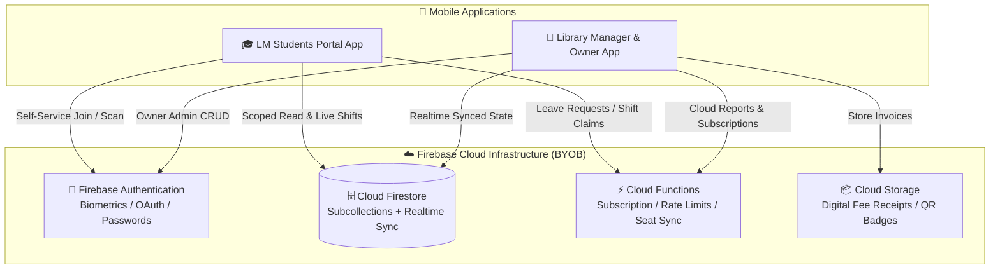

<div align="center">

  

  # 📚 Library Manager Ecosystem
  ### Next-Gen Dual-App SaaS Platform for Library Owners & Students

  <p align="center">
    <b>A high-performance library management ecosystem engineered with Flutter & Firebase.</b>
  </p>

  <!-- Real-Time Auto-Updating Dynamic Badges -->
  <p align="center">
    <a href="https://github.com/OPSHARP/library-manager-ecosystem">
      
    </a>
    &nbsp;
    <a href="https://github.com/OPSHARP/library-manager-ecosystem/stargazers">
      
    </a>
    &nbsp;
    <a href="https://github.com/OPSHARP/library-manager-ecosystem/network/members">
      
    </a>
  </p>

  <!-- Live Google Play Badges -->
  <p align="center">
    <a href="https://play.google.com/store/apps/details?id=com.librarymanager.owner" target="_blank">
      
    </a>
    &nbsp;
    <a href="https://play.google.com/store/apps/details?id=com.librarymanager.student" target="_blank">
      
    </a>
  </p>

  <!-- Tech & License Badges -->
  <p align="center">
    <a href="https://flutter.dev/"></a>
    <a href="https://dart.dev/"></a>
    <a href="https://firebase.google.com/"></a>
    <a href="LICENSE"></a>
  </p>

  <p align="center">
    <a href="#-architecture-overview">Architecture</a> •
    <a href="#-anti-resale--non-commercial-protection">Anti-Resale Policy</a> •
    <a href="#-dual-app-ecosystem--live-store-links">Apps & Links</a> •
    <a href="#-security--zero-secrets-policy">Security</a> •
    <a href="#-getting-started">Setup</a> •
    <a href="#-license--usage-terms">License</a>
  </p>

</div>

---

##  Anti-Resale & Non-Commercial Protection

> [!CAUTION]
> **STRICT PROHIBITION ON SELLING & MONETIZATION**
> 
> This repository and all associated source code are licensed strictly for **personal, educational, and internal non-commercial use**.
> 
> - ❌ **NO COMMERCIAL SALE**: You are strictly forbidden from selling the source code, APKs, AABs, or reskinned versions on **CodeCanyon, Envato, Gumroad, Fiverr, Upwork, Telegram, or any freelancing/marketplace platform**.
> - ❌ **NO CLIENT RESALE**: You may NOT package or reskin this software to sell it to third-party clients or library owners for money.
> - ⚖️ **LEGAL ENFORCEMENT**: Any unauthorized sale or distribution for fee constitutes intentional copyright infringement under the **Indian Copyright Act, 1957** and **DMCA**, and will be immediately subjected to takedown strikes, account bans, and legal claims.

---

##  Architecture Overview

This repository is structured as a unified monorepo housing both client applications:

```
📦 Library Manager Ecosystem
 ├── 📱 android/ & lib/               # Owner App (com.librarymanager.owner)
 ├── 🎓 library_student_app/          # Student Portal App (com.librarymanager.student)
 ├── 📜 LICENSE                       # Non-Commercial & Anti-Resale License
 └── 📄 tos.md                        # Legal & Google Play Trader / DSA Compliance
```



---

##  Dual-App Ecosystem & Live Store Links

### 1. 🏢 Library Manager and Owner (Admin App)
<p>
  <a href="https://play.google.com/store/apps/details?id=com.librarymanager.owner" target="_blank">
    
  </a>
</p>

* **Live Play Store:** [https://play.google.com/store/apps/details?id=com.librarymanager.owner](https://play.google.com/store/apps/details?id=com.librarymanager.owner)
* **Application ID:** `com.librarymanager.owner`
* **Target Audience:** Library Owners, Administrators & Management Staff
* **Core Capabilities:**
  - **Shift-Wise Seat Management**: Visual seat grid supporting multi-shift occupancy (Morning, Afternoon, Evening, Night, Full-Day).
  - **Automated Digital Fee Receipts**: Branded fee receipts, partial payments, discounts, and overdue tracking.
  - **Biometric Security Vault**: Local authentication gate with PIN/Biometric lock and automatic inactivity cooldown.
  - **Offline Attendance Sync**: Zero-downtime offline attendance queue with poison-pill retry guards.
  - **Operational Expense Tracker**: Category-wise expense logging with monthly financial analytics.
  - **Dynamic Notice Board**: Push notices and operational guidelines straight to all registered students.
  - **Auto Cloud Backup**: Multi-chunk Firestore document backups to bypass the 1MB document limit.

---

### 2. 🎓 LM Students Portal (Student Self-Service)
<p>
  <a href="https://play.google.com/store/apps/details?id=com.librarymanager.student" target="_blank">
    
  </a>
</p>

* **Live Play Store:** [https://play.google.com/store/apps/details?id=com.librarymanager.student](https://play.google.com/store/apps/details?id=com.librarymanager.student)
* **Application ID:** `com.librarymanager.student`
* **Target Audience:** Registered Students, Aspirants & Members
* **Core Capabilities:**
  - **One-Tap QR / Code Joining**: Enter library token to bind student profile instantly.
  - **Real-Time Seat Availability**: Live visualization of vacant seats and shifts.
  - **Attendance History & Analytics**: Personal attendance logs with strict PII isolation.
  - **Instant Digital Notices**: Real-time notifications for library timings, fees, holidays, and rules.
  - **Leave Request Management**: Submit and track leave requests with automated seat retention.

---

##  Personal & Internal Setup Guide

For personal, non-commercial use, follow these steps to set up the apps:

### 1. Connect Your Own Firebase (Bring Your Own Backend)
You **MUST** connect the apps to your own Firebase project (the author's backend is completely private):
```bash
# Install FlutterFire CLI:
dart pub global activate flutterfire_cli

# Configure Owner App:
flutterfire configure

# Configure Student App:
cd library_student_app
flutterfire configure
```
This automatically generates your own `lib/firebase_options.dart` and downloads `google-services.json`.

### 2. Setup Release Signing Keystore
Copy `key.properties.example` to `key.properties` and add your own keystore file:
```bash
cp android/key.properties.example android/key.properties
```

---

##  Security & Zero-Secrets Policy

This repository contains **ZERO active backend credentials, API keys, or private keystores**:

| Security Vector | Implementation Detail |
|---|---|
| 🔑 **Zero-Secret Codebase** | All keystore passwords, signing files (`*.jks`, `key.properties`), and private Firebase configuration are 100% excluded via `.gitignore`. Sample templates provided. |
| 🛡️ **Private Backend Isolation** | The author's Cloud Functions, security rules, and databases are strictly private and not exposed in version control. |
| ⚡ **Atomic In-App Purchases** | Google Play subscription validation runs inside Firestore transactions preventing duplicate token reuse attacks. |
| 🔒 **Granular Security Architecture** | Students can NEVER read other students' data or modify seat allocations without validation. |
| 🧬 **Code Minification & Obfuscation** | Release builds enforce R8 shrinking and Dart-level AOT symbol obfuscation with split debug info. |

---

##  Quick Start

```bash
# Clone the repository
git clone https://github.com/OPSHARP/library-manager-ecosystem.git
cd library-manager-ecosystem

# Setup your own Firebase
flutterfire configure

# Run Owner App
flutter pub get
flutter run

# Run Student App
cd library_student_app
flutterfire configure
flutter pub get
flutter run
```

---

##  Production Builds

```powershell
# Build Owner App (AAB + APK with Dart obfuscation)
.\build_release.ps1

# Build Student App (AAB + APK with Dart obfuscation)
cd library_student_app
.\build_release.ps1
```

---

##  License & Usage Terms

This project is licensed under the **SHARP OP Non-Commercial & Anti-Resale Source License (BYOB)**.

- **STRICT ANTI-RESALE**: Selling this code, derivative apps, or reskinned versions is strictly illegal.
- **FREE PERSONAL USE**: You may study, learn, and use this code strictly for personal or internal non-commercial purposes.
- **ZERO BACKEND ACCESS**: You must configure your own separate Firebase project.

See the full [LICENSE](LICENSE) file for complete legal terms.

---

<div align="center">
  <sub>Created by <b>SHARP OP</b> • Enterprise Software Systems</sub>
</div>
